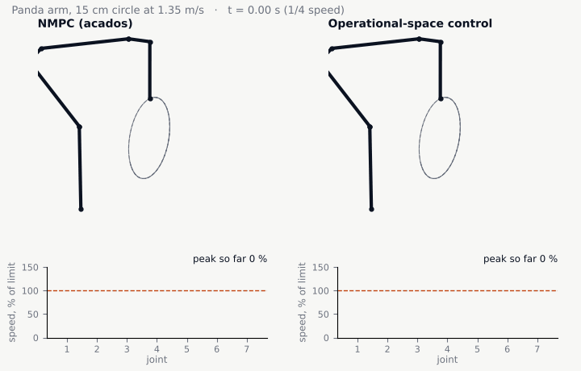
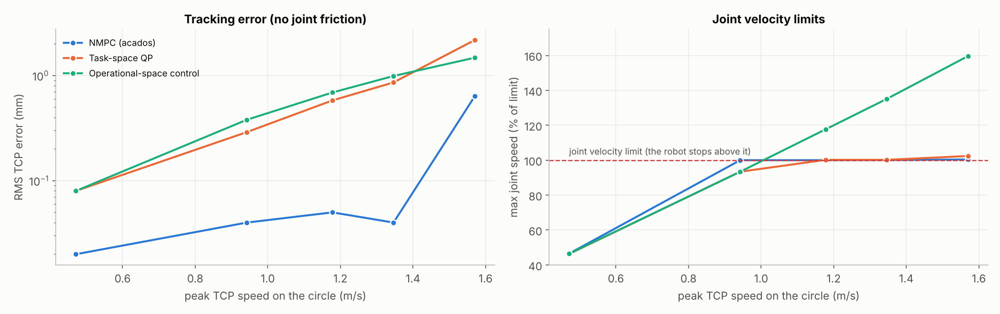
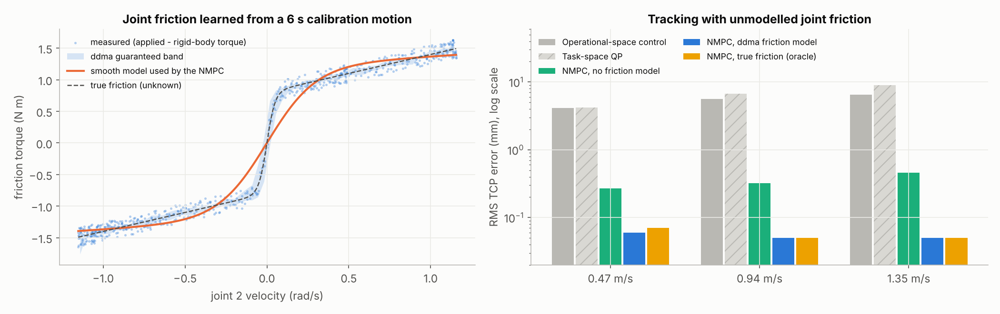

# arm-nmpc: real-time joint-torque NMPC for a 7-joint robot arm

A nonlinear model predictive controller that commands the seven joint torques of a
Franka Emika Panda directly. It moves the tool centre point (TCP) around a fast circle
with sub-millimetre accuracy, within the joint velocity and torque limits. Every
control step plans 0.35 s ahead on the full rigid-body dynamics in a few milliseconds.

The controller is compared against operational-space control and a task-space QP, the
standard tools for torque-controlled arms. It also uses a joint-friction model learned
from a 6 s calibration motion, whose error is **certified** by
[ddma](https://github.com/anas-makdesi/ddma).



*15 cm circle at 1.35 m/s, shown at quarter speed: the NMPC keeps every joint within its velocity limit; operational-space control drives a joint to 135 % of its limit, where a real Panda stops ([script](examples/demo_gif.py)).*

| | |
|---|---|
| **0.04 mm** | RMS TCP error at 1.35 m/s, with every joint within 0.1 % of its velocity limit. The QP baseline gets 0.86 mm; operational-space control gets 0.99 mm but exceeds a velocity limit by 35 %, which stops a real Panda |
| **≈ 3.5 ms** | median solve time per step at 100 Hz (14 states, 7 torques, Panda dynamics in the model) |
| **≈ 100× smaller error** | than the baselines when the arm has joint friction they don't model: 0.05 mm vs 5–9 mm. ddma's friction model matches an oracle that knows the true parameters |
| **0.3–0.7 N m** | certified worst-case error of the learned friction model per joint |



## What it does

| 1 · Model | 2 · Optimise in real time | 3 · Learn the friction | 4 · Deploy |
|---|---|---|---|
| Panda rigid-body dynamics (articulated-body algorithm) written in CasADi and checked against Pinocchio | acados, joint torques as inputs, Gauss-Newton real-time iteration, HPIPM, warm start shifted in time | ddma certifies a band around each joint's friction curve; a smooth model inside it goes into the NMPC | Generated C code (solver and dynamics) in ROS 2 C++ nodes; a 1 kHz loop that applies the NMPC's own feedback gain between steps; parity tests |

The cost tracks the TCP reference. It also includes a posture term that resolves the
arm's redundancy and a small effort term beyond gravity compensation. Constraints:
joint torque limits (hard), and joint velocity and position limits (soft, heavily
penalised).

Because it plans ahead, the controller slows the joints before they reach their
velocity limits and redistributes the motion over the redundant joints. One-step
controllers only find out when a limit is hit.

## Results

### Speed sweep: TCP circle, radius 15 cm, no joint friction

| Peak TCP speed | NMPC (acados) | Task-space QP | Operational-space control |
|---|---|---|---|
| 0.47 m/s | **0.02 mm** · 47 % | 0.08 mm · 46 % | 0.08 mm · 46 % |
| 0.94 m/s | **0.04 mm** · 100 % | 0.29 mm · 93 % | 0.38 mm · 93 % |
| 1.18 m/s | **0.05 mm** · 100 % | 0.58 mm · 100 % | 0.69 mm · **118 %** |
| 1.35 m/s | **0.04 mm** · 100 % | 0.86 mm · 100 % | 0.99 mm · **135 %** |
| 1.57 m/s | **0.64 mm** · 100 % | 2.2 mm · 102 % | 1.5 mm · **160 %** |

Each cell gives the RMS TCP error after the speed ramp, then the highest joint speed as a
share of its limit. Above 100 % a real Panda triggers its safety stop.

*Baselines:*
* **Operational-space control:** task-space inverse dynamics with feedforward and PD,
  null-space posture task, torques clipped to their limits.
* **Task-space QP:** the same task acceleration, solved each step with torque limits and
  one-step joint velocity and position limits (OSQP), as in whole-body control frameworks.

Both know the exact rigid-body model.

### Joint friction: learned with a certified bound

The simulated arm has viscous and Coulomb friction in every joint, which the
controllers don't model. Before the task, the arm does a 6 s joint-space sine sweep.
For each sample, the friction torque is the applied torque minus the rigid-body torque
(noise ±0.15 N m). With the prior that friction never decreases with speed and has
bounded slope, ddma's `GrowthMap` gives a band that contains the true friction curve.
A smooth model (viscous + `tanh` Coulomb) is fitted inside the band. Its certified
worst-case error over the calibrated speeds is **0.68, 0.63, 0.57, 0.57, 0.35, 0.38,
0.30 N m** (joints 1–7).

| RMS TCP error, with friction | 0.47 m/s | 0.94 m/s | 1.35 m/s |
|---|---|---|---|
| Operational-space control | 4.1 mm | 5.7 mm | 6.5 mm |
| Task-space QP | 4.2 mm | 6.7 mm | 9.0 mm |
| NMPC, no friction model | 0.27 mm | 0.32 mm | 0.46 mm |
| **NMPC, ddma friction model** | **0.06 mm** | **0.05 mm** | **0.05 mm** |
| NMPC, true friction parameters (oracle) | 0.07 mm | 0.05 mm | 0.05 mm |

Even without a friction model the NMPC beats the baselines by more than 10×: it rejects
the unmodelled friction through its stiff, constraint-aware feedback. The learned model
gives a further 5–9×.



### Timing

All values were measured in closed loop, two laps at 1.35 m/s, 100 Hz. They give acados'
internal solve time.

| Controller | Median | p99 | Worst | Over 10 ms | Error | Max joint speed |
|---|---|---|---|---|---|---|
| **NMPC, N = 15 (experiments above)** | **3.5 ms** | 7.7 ms | 14 ms | 0.4 % | 0.04 mm | 100 % |
| NMPC, N = 10 (ROS 2 node) | 2.6 ms | 5.4 ms | 12 ms | 0.4 % | 0.11 mm | 100 % |
| Task-space QP (OSQP) | 1.1 ms | 1.7 ms | 1.8 ms | 0 % | 0.86 mm | 100 % |
| Operational-space control | 0.56 ms | 0.85 ms | 1.8 ms | 0 % | 0.99 mm | 135 % |

* **What made real-time iteration work here:** shifting the previous solution forward in
  time before each step. Without it, the linearisation is one step stale. The arm then
  overshoots joint velocity limits by up to 25 % between samples, even though every plan
  respects them.

### Free-running loop: the NMPC's own feedback at 1 kHz

On a torque-controlled arm the NMPC does not drive the motors directly. The robot runs its
own 1 kHz loop, and the NMPC sends it a new command every 10 ms, a few milliseconds after
the state it was computed for. In the ROS 2 free-running mode (`mode:=realtime`) the
simulator plays that loop. Three things make it work:

* **Delay compensation:** the NMPC node predicts the state forward by its expected
  latency, through the robot's 1 kHz law with the last command it sent, and solves for
  that predicted state and time.
* **The NMPC's own gain in the 1 kHz loop:** each command carries the feedback gain K of
  the QP the solver just solved (7 × 14, a backward Riccati recursion over its stage
  matrices). Between NMPC steps the robot applies the planned torque plus K (x − x_plan).
  That stiffness follows the NMPC's cost: stiff where the TCP cost acts, soft in the
  arm's null space. A fixed joint impedance (Franka's example gains) pulls on every joint,
  including the null space, and there it fights the NMPC: joints 1 and 3 swing up to 2×
  their velocity limits.
* **A plan, not a step:** each command carries the first 40 ms of the plan (states and
  torques). When a command is late, the robot keeps following the plan instead of
  extrapolating the first interval.

ROS 2 runs, circle at 0.94 m/s, NMPC with the ddma friction model, 6 s each:

| 1 kHz loop | Runs | RMS TCP error | Max joint speed |
|---|---|---|---|
| Fixed joint impedance, first interval only (0.1.0) | 4 | 0.6–1.6 mm | 190–212 % |
| NMPC gain, first interval only | 4 | 0.2–1.0 mm | 100–220 % |
| Fixed joint impedance, plan | 3 | 0.7–2.2 mm | 158–162 % |
| **NMPC gain, plan (current)** | 13 | **0.16–0.50 mm** in 12 runs | **94–101 %** in 12 runs |
| Lockstep (reference, no timing effects) | 1 | 0.09 mm | 100 % |

These runs share a 2-core virtual machine whose host now and then takes the CPU away for
about 150 ms: NMPC steps then take 11.5 ms instead of about 3 ms, longer than the 10 ms
period. Most runs had a few such episodes. In one of the 13 runs they were much heavier
(solve times p99 14 ms), and that run reached 207 % and 1.6 mm. Without a friction model:
0.34–0.72 mm, at most 100 % (3 runs).

The same comparison in a deterministic model of the loop (`anmpc.realtime`), with a
constant 3.5 ms delay and with modelled CPU-starvation episodes (3 seeds):

| 1 kHz loop | Constant delay | With starvation episodes |
|---|---|---|
| Fixed joint impedance, first interval only (0.1.0) | 0.08 mm · 201 % | 1.3–2.4 mm · 200–220 % |
| NMPC gain, first interval only | 0.10 mm · 100 % | 2.0–2.6 mm · 152–194 % |
| Fixed joint impedance, plan | 0.15 mm · 160 % | 1.6–1.7 mm · 161–165 % |
| **NMPC gain, plan (current)** | **0.10 mm · 96 %** | **0.29–0.40 mm** · 98 %, 101 %, 202 % |

In the third seed, one episode still drives joint 7 (the rotation about the tool axis,
which the TCP cost barely constrains) to 2× its limit for a few milliseconds.

## Engineering

* **Dynamics written once, checked against Pinocchio:** forward kinematics, RNEA, mass
  matrix and ABA match Pinocchio to 10⁻⁹ to 10⁻¹². The same CasADi expressions go into
  acados and, through CasADi code generation, into C for the ROS 2 nodes.
* **C++ / ROS 2 Jazzy** (`ros2/`):
  * `arm_nmpc_msgs`: `ArmState`, `JointTorques` (the first 40 ms of the plan and the
    NMPC's feedback gain), `ControllerStats`.
  * `arm_nmpc_ros`:
    * `nmpc_node` runs the generated solver and computes the feedback gain; the friction
      model is a run-time parameter.
    * `sim_node` runs the generated ABA with joint friction and torque saturation at 1 kHz,
      and the robot's 1 kHz loop (`inner_loop.hpp`, shared with the NMPC node's delay
      prediction).
* **Parity tests:**
  * C++ dynamics vs Python: 10⁻¹⁰;
  * C++ plant with friction: 10⁻⁹;
  * C++ solver wrapper vs the Python controller over 150 closed-loop steps: 7·10⁻⁵ of the
    torque range, within the QP tolerance;
  * C++ feedback gain vs Python over the same steps: 10⁻³ relative; the Python gain vs
    finite differences of the real-time iteration: within the QP tolerance.

  A launch test runs the closed loop and checks tracking error, joint-velocity limits and
  solver status.
* **Lockstep ROS 2 runs** (`mode:=lockstep`, used by the tests): the simulator waits for
  each command, so results are deterministic and match the Python study. 0.43 mm RMS without the friction model,
  **0.09 mm with the ddma model**; 2.9 ms median solve. The loop runs about twice as fast
  as real time.
* **Free-running real-time mode** (the launch file's default): the NMPC's gain in the
  1 kHz loop (see above); `inner_loop:=pd` for the fixed joint impedance.
* **CI** (GitHub Actions): ruff, pytest (with acados built from a pinned commit, and
  Pinocchio), and `colcon build` plus `colcon test` in a `ros:jazzy` container. **Docker**
  image.

## Quick start

```bash
scripts/install_acados.sh ~/acados
export ACADOS_SOURCE_DIR=~/acados LD_LIBRARY_PATH=$LD_LIBRARY_PATH:~/acados/lib
pip install -e ".[dev]"
pip install -e ".[friction]"   # ddma v0.12.0, for the friction certificate

python examples/circle_comparison.py   # experiments above -> results/circle.json, figures
python examples/benchmark.py           # timing table -> results/timing.json
python examples/realtime_loop.py       # model of the free-running loop -> results/realtime_loop.json
pytest -q
```

```python
from anmpc.task import Circle, NO_FRICTION
from anmpc.nmpc import NMPC, NMPCConfig
from anmpc.sim import run

task = Circle(period=0.7)                       # 1.35 m/s peak TCP speed
result = run(NMPC(task, NMPCConfig()), task, duration=task.ramp + 2 * task.period,
             friction=NO_FRICTION)
print(result.summary())
```

ROS 2 (Jazzy):

```bash
python scripts/export_c_code.py
mkdir -p ~/ws && ln -s $PWD/ros2 ~/ws/src && cd ~/ws
colcon build --cmake-args -DCMAKE_BUILD_TYPE=Release && source install/setup.bash
ros2 launch arm_nmpc_ros circle.launch.py period:=1.0                  # free-running
ros2 launch arm_nmpc_ros circle.launch.py period:=1.0 mode:=lockstep   # deterministic
python3 src/arm_nmpc_ros/scripts/arm_probe.py --seconds 5   # summary of the run
```

Docker: `docker build -f docker/Dockerfile -t arm-nmpc . && docker run --rm -it arm-nmpc`.

## Repository layout

```
src/anmpc/      panda_data (generated parameters), dynamics (FK, RNEA, ABA in CasADi), task,
                plant, nmpc (acados), baselines (OSC, task-space QP), friction (ddma), sim,
                realtime (model of the free-running loop)
examples/       circle_comparison.py, benchmark.py, realtime_loop.py
scripts/        install_acados.sh, extract_panda.py, export_c_code.py, make_cpp_fixtures.py
ros2/           arm_nmpc_msgs, arm_nmpc_ros (nodes, launch, tests, probe)
results/        JSON outputs of the examples and of the ROS 2 runs
```

The Panda's kinematic and inertial parameters come from `panda.urdf` in
example-robot-data (BSD-3-Clause), based on franka_description (Apache-2.0). Only the
numbers are copied (`src/anmpc/panda_data.py`).

## Modelling notes and assumptions

* **What the simulation models.** The arm uses the same rigid-body model as the
  controllers, plus joint friction and torque saturation. The next robustness tests add
  motor dynamics, joint elasticity and sensor noise.
* **What the friction certificate assumes.** Friction is a non-decreasing function of
  joint speed with bounded slope, and measurement errors stay within the stated bound.
  The error bound is given over the calibrated speed range.
* **Timings** vary by about ±30 % between runs on a shared machine. The tables give
  rounded values from one run.
* **Feedback gain.** The gain is exact while no inequality constraint is active; a
  saturated torque has zero sensitivity, and the robot keeps it saturated.
* **Free-running results** depend on the machine: on a dedicated core with real-time
  scheduling the NMPC overruns its period less often than on the shared test machine.

## Next

Deadline handling for the free-running loop (what the robot does when the NMPC overruns
for longer than the plan it sent, and a damping floor for the tool-axis joint); obstacle
and self-collision constraints; a payload with certified mass bounds; a hardware run on a
Panda through `franka_ros2`.

---
Developed with help from Claude (Anthropic) for code, experiments and documentation.
